<div align="center">



<br>

<a href="https://github.com/AlanHerrera01"></a>
<a href="https://www.linkedin.com/in/alan-herrera-araujo-6a823a339/"></a>
<a href="mailto:tu@correo.com"></a>

<br><br>


</div>

<br>

## ❯ whoami

```bash
❯ whoami
alan-herrera · full stack developer · applied AI

❯ cat status.txt
🟢 en línea — abierto a colaboraciones y oportunidades laborales
```

<div align="center">


</div>

<br>

## ❯ technical_arsenal

<table>
  <tr>
    <td width="34%" valign="top" align="center">
      <sub><code>BACKEND &amp; SISTEMAS</code></sub><br><br>
      
    </td>
    <td width="33%" valign="top" align="center">
      <sub><code>FRONTEND &amp; WEB</code></sub><br><br>
      
    </td>
    <td width="33%" valign="top" align="center">
      <sub><code>INFRA &amp; DESPLIEGUE</code></sub><br><br>
      
    </td>
  </tr>
</table>

<br>

## ❯ featured_repositories

<table>
  <tr>
    <td width="50%" valign="top">

<sub>🔴 🟡 🟢 &nbsp; <code>~/projects/nexus.py</code></sub>

### 🧠 [NEXUS](https://github.com/AlanHerrera01/NEXUS-Personal-AI-Operating-System)
**Personal AI Operating System**

IA personal que recuerda lo importante, entiende tu contexto, usa tus herramientas y ejecuta tareas por ti, con tus datos y permisos bajo tu control.


</td>
    <td width="50%" valign="top">

<sub>🔴 🟡 🟢 &nbsp; <code>~/hackathon/copago-agent</code></sub>

### 🏥 [Agéntico de Copago y Cobertura](https://github.com/AlanHerrera01/Agentico-de-Copago-y-Cobertura-para-el-Paciente)
**Reto de hackathon**

Agente inteligente para calcular copagos y cobertura de pacientes.


</td>
  </tr>
  <tr>
    <td width="50%" valign="top">

<sub>🔴 🟡 🟢 &nbsp; <code>~/deploy/amallulia</code></sub>

### 🚀 [Amallulia](https://github.com/AlanHerrera01/amallulia)
**Aplicación web desplegada**

Proyecto en producción sobre Vercel. [Ver demo →](https://amallulia.vercel.app)


</td>
    <td width="50%" valign="top">

<sub>🔴 🟡 🟢 &nbsp; <code>~/devops/ci-avanzada</code></sub>

### ⚙️ [CI Avanzada](https://github.com/AlanHerrera01/CI-Avanzada)
**CI/CD con GitHub Actions y Spring Boot**

Automatización de pruebas y despliegue para una aplicación Spring Boot.


</td>
  </tr>
</table>

<br>

## ❯ repositories --by-language

<details open>
<summary><b>🐍 Python</b></summary>
<br>

| Proyecto | Descripción |
|----------|-------------|
| [**NEXUS · Personal AI OS**](https://github.com/AlanHerrera01/NEXUS-Personal-AI-Operating-System) | IA personal con memoria, contexto y ejecución de tareas. |
| [**Amallulia**](https://github.com/AlanHerrera01/amallulia) · [demo](https://amallulia.vercel.app) | Aplicación web desplegada en Vercel. |
| [**TEST ARCHON · BOB IBM**](https://github.com/AlanHerrera01/TEST-ARCHON---BOB-IBM) · [demo](https://test-archon-bob-ibm.vercel.app) | Proyecto desplegado en Vercel. |
| [**SIAA · ChargeGuard**](https://github.com/AlanHerrera01/SIAA-ChargeGuard) | Proyecto en Python con licencia MIT. |
| [**ALF · Omnimanip VLA**](https://github.com/AlanHerrera01/ALF-Omnimanip-VLA) | Manipulación robótica con modelos visión-lenguaje-acción. |
| [**Taller 1**](https://github.com/AlanHerrera01/Taller1) | Ejercicios de práctica en Python. |
| [**Deber Docker · DB**](https://github.com/AlanHerrera01/DeberDocker_DB) | Tarea de contenedores y bases de datos con Docker. |

</details>

<details open>
<summary><b>☕ Java</b></summary>
<br>

| Proyecto | Descripción |
|----------|-------------|
| [**Agéntico de Copago y Cobertura**](https://github.com/AlanHerrera01/Agentico-de-Copago-y-Cobertura-para-el-Paciente) | Reto de hackathon para cálculo de copagos. |
| [**CI Avanzada**](https://github.com/AlanHerrera01/CI-Avanzada) | CI/CD con GitHub Actions y Spring Boot. |
| [**Proyecto Distribuidas P3**](https://github.com/AlanHerrera01/Proyecto_Distribuidas_P3) | Proyecto final de aplicaciones distribuidas. |
| [**Proyecto Distribuidas Backend P2**](https://github.com/AlanHerrera01/Proyecto_Distribuidas_Backend_P2) | Backend del proyecto distribuido. |
| [**Springlab**](https://github.com/AlanHerrera01/Springlab-AlanHerrera) | Laboratorio práctico de Spring. |
| [**Pilas en C, Java y Python**](https://github.com/AlanHerrera01/PILAS_C_JAVA_PYTHON) | Pilas implementadas en varios lenguajes. |
| [**Herrera Alan · Examen P3**](https://github.com/AlanHerrera01/HerreraAlan_ExamenP3) | Evaluación práctica en Java. |
| [**Herrera Alan · Examen**](https://github.com/AlanHerrera01/HerreraAlan_Examen) | Evaluación práctica en Java. |
| [**Herrera Alan · Lab 2**](https://github.com/AlanHerrera01/HerreraAlan_Lab2) | Laboratorio 2 en Java. |
| [**Herrera Alan · Lección 1**](https://github.com/AlanHerrera01/HerreraAlan_Leccion1) | Lección 1 en Java. |
| [**Banquito · File Reception Service**](https://github.com/AlanHerrera01/banquito-file-reception-service) | Servicio de recepción de archivos (fork de equipo). |

</details>

<details open>
<summary><b>🟦 TypeScript · JavaScript</b></summary>
<br>

| Proyecto | Descripción |
|----------|-------------|
| [**Proyecto Distribuidas P2**](https://github.com/AlanHerrera01/Proyecto_Distribuidas_P2) | Frontend del proyecto distribuido (TypeScript). |
| [**Proyecto Avanzada P3**](https://github.com/AlanHerrera01/Proyecto_Avanzada_P3) | Proyecto de programación avanzada (TypeScript). |
| [**MedGuard AI · Evolus AMD**](https://github.com/AlanHerrera01/MedGuard-AI-Track-Evolus-AMD-) | IA en salud para hackathon (JavaScript). |
| [**Examen Distribuido P3**](https://github.com/AlanHerrera01/Examen_DistribuidoP3) | Evaluación práctica (JavaScript). |
| [**Examen PIC P2**](https://github.com/AlanHerrera01/Examen_PIC_P2) | Evaluación práctica (TypeScript). |
| [**Herrera Alan · Examen 2**](https://github.com/AlanHerrera01/HerreraAlan_Examen2) | Evaluación práctica (JavaScript). |
| [**Proyecto P1**](https://github.com/AlanHerrera01/Proyecto_P1) | Primer proyecto (JavaScript). |
| [**Lab 1 · PIC 2025**](https://github.com/AlanHerrera01/Lab1_PIC2025) | Laboratorio 1 de PIC (JavaScript). |

</details>

<details open>
<summary><b>🐘 PHP · HTML · SCSS (web)</b></summary>
<br>

| Proyecto | Descripción |
|----------|-------------|
| [**PayLab · SIGS Parcial 3**](https://github.com/AlanHerrera01/PayLab-SIGS-Parcial3) | Laboratorio de pagos para la materia SIGS (PHP). |
| [**WEB2 · PHP**](https://github.com/AlanHerrera01/WEB2-PHP) | Proyecto web de la materia Web 2 (PHP). |
| [**Proyecto WEB2EW**](https://github.com/AlanHerrera01/PROYECTO-WEB2EW) | Proyecto web con estilos SCSS. |
| [**Tarea 01 · Web 2**](https://github.com/AlanHerrera01/Tarea01_Web2.io) | Tarea de Web 2 (PHP). |
| [**AlanHerrera01.github.io**](https://github.com/AlanHerrera01/AlanHerrera01.github.io) | Proyecto PIII FW (PHP). |
| [**3788 · Grupo 02 · Lab**](https://github.com/AlanHerrera01/3788_GRUPO02_LAB) | Laboratorio grupal (HTML). |
| [**3788 · Grupo 02 · Lab Scroll**](https://github.com/AlanHerrera01/3788_GRUPO02_LAB_Scroll) | Laboratorio grupal con scroll (HTML). |
| [**Avherrera3.github.io**](https://github.com/AlanHerrera01/Avherrera3.github.io) | Sitio web estático (HTML). |

</details>

<details open>
<summary><b>⚙️ C++</b></summary>
<br>

| Proyecto | Descripción |
|----------|-------------|
| [**Estructuras de Datos (E.D.D)**](https://github.com/AlanHerrera01/E.D.D) | Implementaciones de estructuras de datos. |
| [**Listas en C++ y Python**](https://github.com/AlanHerrera01/LISTAS_CPLUSPLUS_PYTHON) | Operaciones sobre listas: agregar, insertar y eliminar. |
| [**Trabajo Grupal**](https://github.com/AlanHerrera01/TrabajoGrupal) | Trabajo grupal en C++. |

</details>

<details>
<summary><b>📁 Otros (documentación y repos sin lenguaje detectado)</b></summary>
<br>

| Proyecto | Descripción |
|----------|-------------|
| [**Auditor VOICE · AVHA**](https://github.com/AlanHerrera01/Auditor-VOICE-AVHA) | Repositorio de proyecto en preparación. |
| [**git-api**](https://github.com/AlanHerrera01/git-api) | Práctica con la API de Git. |
| [**Documentación PPP · Herrera**](https://github.com/AlanHerrera01/5166_Documentacion_PPP_Herrera) | Documentación de las prácticas (PPP). |
| [**Proyecto PIII F.W**](https://github.com/AlanHerrera01/ProjectoPIIIF.W) | Proyecto de la materia PIII. |

</details>

<br>

## ❯ git log --collab

| Proyecto | Tipo | Tecnología |
|----------|------|------------|
| [**Hackathon Inter-Ciber**](https://github.com/AlanHerrera01/HackathonInter-Ciber) | 🏆 Hackathon |  |
| [**Agéntico de Copago y Cobertura**](https://github.com/AlanHerrera01/Agentico-de-Copago-y-Cobertura-para-el-Paciente) | 🏆 Reto de hackathon |  |
| [**MedGuard AI · Evolus AMD**](https://github.com/AlanHerrera01/MedGuard-AI-Track-Evolus-AMD-) | 🏆 Hackathon |  |
| [**Banquito · File Reception Service**](https://github.com/AlanHerrera01/banquito-file-reception-service) | 🤝 Fork de equipo |  |
| [**Trabajo Grupal**](https://github.com/AlanHerrera01/TrabajoGrupal) | 👥 Proyecto grupal |  |
| [**3788 · Grupo 02 · Lab**](https://github.com/AlanHerrera01/3788_GRUPO02_LAB) | 👥 Laboratorio grupal |  |

<br>

## ❯ telemetry

<div align="center">


<br>


<br>


<br>


</div>

<br>

<div align="center">


<br><br>

<code>❯ ¿Tienes una idea o quieres colaborar? Escríbeme.</code>

</div>


